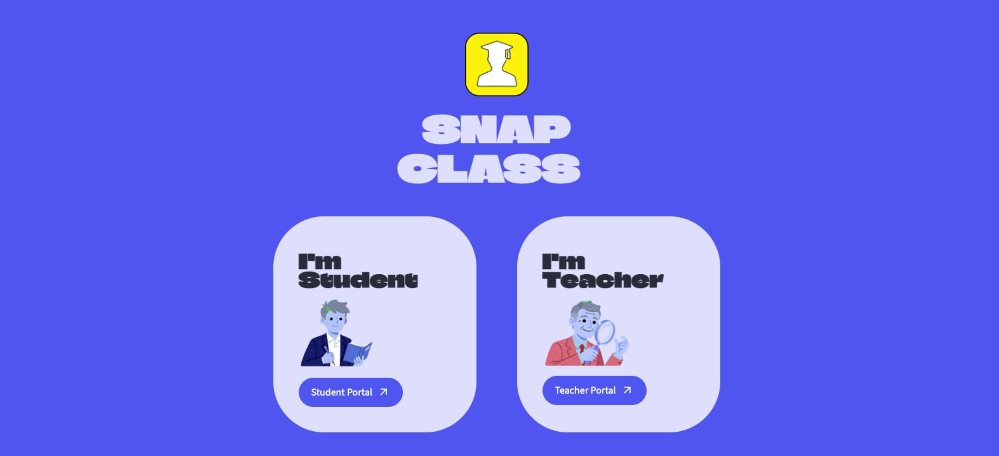
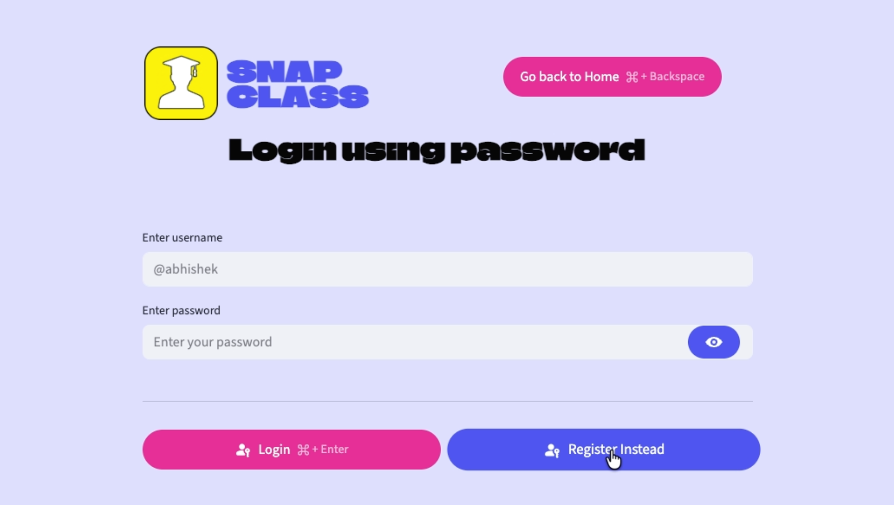
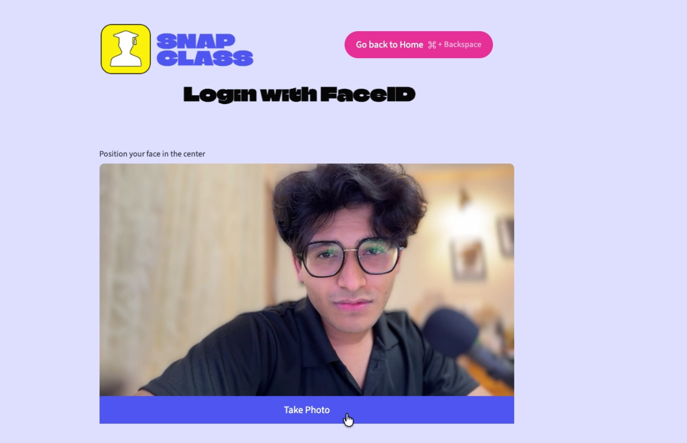
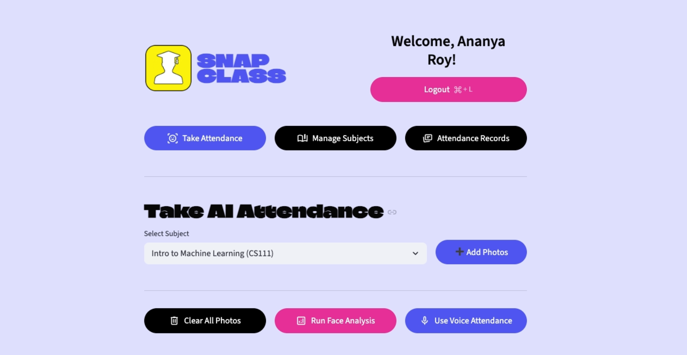
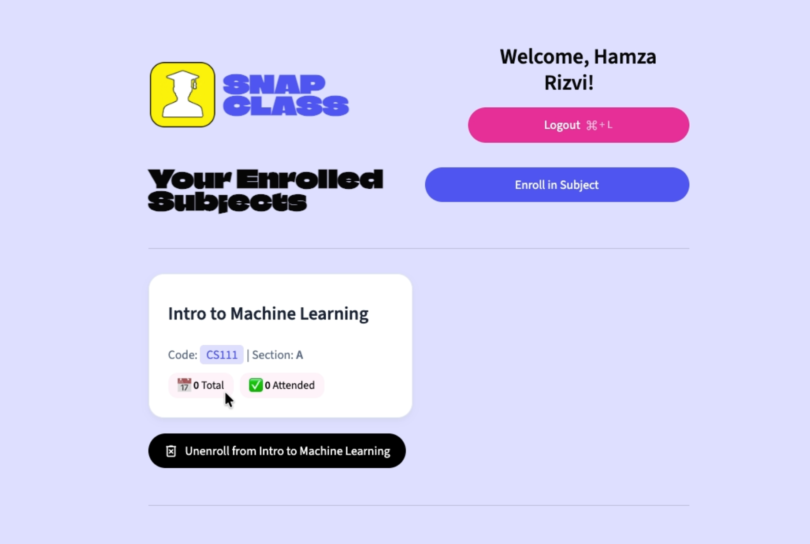
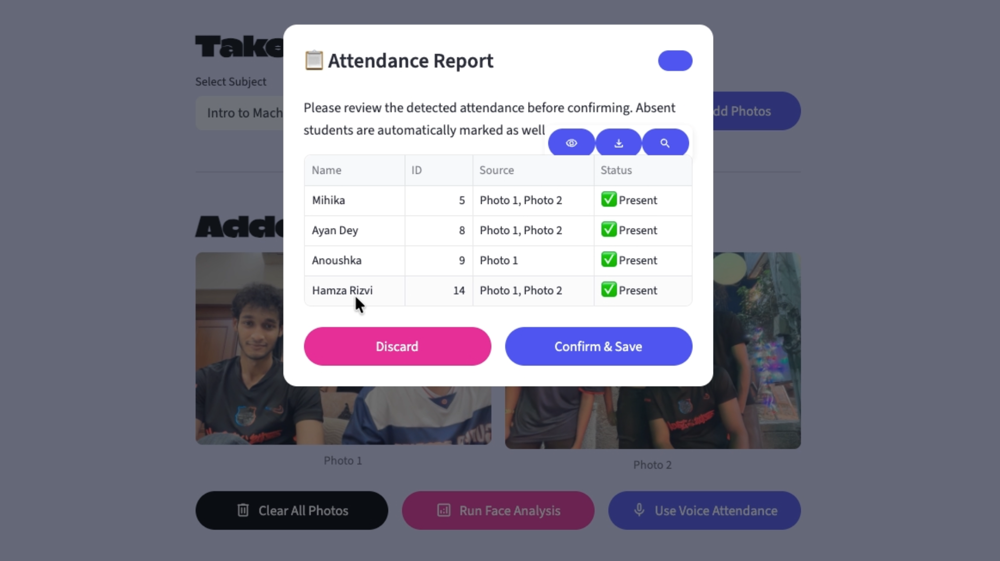
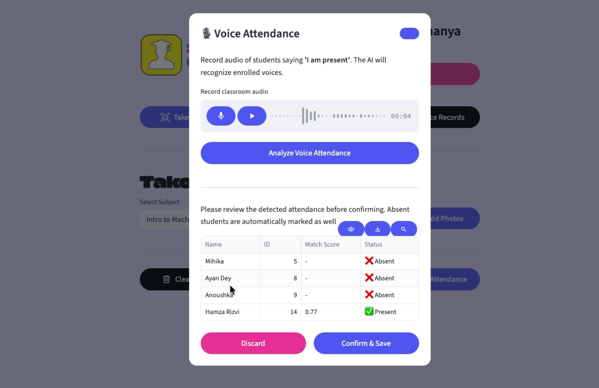
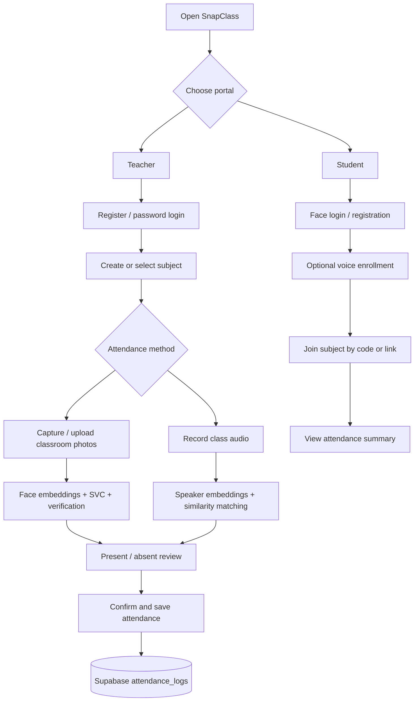

<div align="center">

# 📸 SnapClass

### AI-Powered Classroom Attendance Management

**Recognize students from classroom photos or voice recordings, manage subjects, and track attendance in one Streamlit application.**

[](https://www.python.org/)

[](https://streamlit.io/)

[](https://supabase.com/)

[](#recognition-pipelines)

[Explore the code](https://github.com/Tarush23/SnapClass) · []()

[](https://snapclass-bytarush.streamlit.app/)

</div>

> ****Project status:**** Functional modules are implemented in the repository, but no automated test results or production-readiness claims are provided. The application URL is referenced in source code; its current availability has not been independently verified.

## Overview

****SnapClass**** is a classroom attendance management project that combines computer vision, speaker embeddings, and a database-backed web interface to reduce manual attendance work. Teachers manage courses and initiate attendance sessions; students register with a face profile, optionally add a voice profile, enrol in subjects, and monitor their attendance.

Instead of requiring a separate manual roll call for every student, the teacher can analyse one or more classroom images ****or**** an audio recording. The application matches observations against registered profiles, prepares a present/absent report for students enrolled in the selected subject, and lets the teacher ****review the results before saving****.

## Features

### 👩‍🏫 Teacher portal

- Username/password registration and login; passwords are hashed with ****bcrypt**** before storage.

- Create subjects with a subject code, name, and section.

- View subjects along with enrolled-student and class counts.

- Share subject codes and a join link with students.

- Capture photos through a camera or upload multiple classroom images (`.jpg`, `.jpeg`, `.png`).

- Analyse classroom images to identify registered students and prepare attendance.

- Record audio and run a voice-based attendance workflow for students with enrolled voice profiles.

- Review a generated attendance report before confirming and saving it.

- View subject-specific attendance records.

### 🎓 Student portal

- Register with a name and a face embedding derived from a camera photo.

- Optionally record a voice sample for future voice-based attendance.

- Log in through face recognition using a webcam image.

- Join subjects using a teacher-provided subject code or an enrolment link.

- See enrolled subjects, total classes, attended classes, and attendance percentages.

## 📸 Application Screenshots

### Home Page



### Teacher Login



### Student Face Login



### Teacher Dashboard



### Student Dashboard



### Face Recognition Attendance



### Voice Recognition Attendance




## Recognition pipelines

### 1. Face-based recognition

1. ****Enrollment:**** The student's camera image is processed with a ****Dlib frontal face detector**** and a ****68-point facial-landmark predictor****.

2. ****Embedding:**** Dlib's face-recognition model converts the detected face into a ****128-dimensional embedding****, stored in Supabase.

3. ****Classification:**** Stored face embeddings are used to fit a ****linear Support Vector Classifier (SVC)**** from scikit-learn.

4. ****Verification:**** The predicted student's stored embedding is compared with the observed embedding using ****Euclidean distance****. The current code uses a threshold of ****0.6****.

5. ****Attendance:**** Across the submitted images, recognized student IDs are matched against enrollment in the chosen subject; the teacher receives a present/absent review table.

The application includes a single-profile fallback when only one enrolled face identity is available in the model. The recognition threshold is a code setting, ****not a reported accuracy or validation result****.

### 2. Voice-based recognition

1. Students may record an optional voice sample during registration.

2. ****Librosa**** loads audio at a target sample rate of ****16 kHz****; ****Resemblyzer**** creates a speaker embedding.

3. For attendance, the teacher records an audio clip from the classroom.

4. Librosa identifies non-silent intervals; short segments are skipped.

5. Each segment is embedded and compared against enrolled students' saved voice embeddings using a ****dot-product similarity score****.

6. Matches meeting the configured ****0.65**** threshold are included in the attendance review.

> The implemented audio workflow uses silence-based segmentation and embedding similarity. It does ****not**** implement a dedicated speaker diarization model, nor does this README claim benchmarked recognition accuracy or spoofing resistance.

## How it works



## Tech stack

| Layer | Technologies | Purpose |

| --- | --- | --- |

| Web application | Python, Streamlit | UI, role-specific dashboards, camera/audio input, session state |

| Face processing | Dlib, `face_recognition_models`, NumPy | Face detection, landmarks, 128-D face embeddings |

| Face classification | scikit-learn SVC | Student identity prediction |

| Voice processing | Librosa, Resemblyzer | Audio preprocessing and speaker embeddings |

| Data persistence | Supabase | Teachers, students, subjects, enrollment, attendance records |

| Authentication | bcrypt, Streamlit session state | Teacher password hashing/checking and client session flow |

| QR generation | Segno | QR graphic generation for sharing a subject |

| Data display | pandas, Pillow | Attendance tables and image loading |

## Project structure

```text

SnapClass/

├── app.py                         # Streamlit entry point and routing

├── requirements.txt               # Python dependencies

├── src/

│   ├── screens/

│   │   ├── home_screen.py         # Choose student or teacher portal

│   │   ├── teacher_screen.py      # Teacher authentication

│   │   └── student_screen.py      # Student face login and registration

│   ├── dashboard/

│   │   ├── teacher_dashboard.py   # Subject management and attendance

│   │   └── student_dashboard.py   # Enrollment and attendance summaries

│   ├── pipelines/

│   │   ├── face_recoginition.py   # Dlib embeddings and SVC pipeline

│   │   └── voice_recoginition.py  # Resemblyzer speaker matching

│   ├── database/

│   │   ├── config.py              # Supabase client from Streamlit secrets

│   │   └── db.py                  # Database helper functions

│   ├── components/                # Dialogs, cards, headers and footers

│   └── ui/

│       └── base_layout.py        # Shared UI styling

├── screenshots/                  # Application screenshots
├── README.md
└── .gitignore

```

**The `recoginition` spelling above matches the current filenames in the repository.**

## Data model

The application queries the following Supabase tables:

| Table | Key fields used by the application | Function |

| --- | --- | --- |

| `teachers` | `teacher_id`, `name`, `username`, `password` | Teacher accounts |

| `students` | `student_id`, `name`, `face_embedding`, `voice_embedding` | Student profiles and biometric embeddings |

| `subjects` | `subject_id`, `subject_code`, `name`, `section`, `teacher_id` | Teacher-created subjects |

| `subject_students` | `subject_id`, `student_id` | Subject enrollment |

| `attendance_logs` | `subject_id`, `student_id`, `timestamp`, `is_present` | Attendance events |

These fields are ****inferred from database queries in the code****, not from a published SQL schema. You must configure the corresponding tables, relationships, permissions, and row-level security policies for your own Supabase project.

## Run locally

### Prerequisites

- Python and pip (use a version supported by the native Dlib/Resemblyzer dependencies; Python 3.12 is a reasonable starting point, but wheel availability depends on platform).

- Git.

- A Supabase project with the expected tables and access policies.

- Camera/microphone access for the relevant features.

### 1. Clone the repository

```bash

git clone https://github.com/Tarush23/SnapClass.git

cd SnapClass

```

### 2. Create and activate a virtual environment

**Windows PowerShell**

```powershell

py -3.12 -m venv .venv

.\.venv\Scripts\Activate.ps1

```

****macOS/Linux**** (using a compatible installed Python)

```bash

python3 -m venv .venv

source .venv/bin/activate

```

### 3. Install the dependencies

```bash

python -m pip install --upgrade pip

pip install -r requirements.txt

```

> `requirements.txt` currently installs `face_recognition_models` from GitHub and native Dlib-related dependencies. Installation may need compatible wheels/build tools. The repository does not currently pin a fully reproducible environment.

### 4. Configure Supabase credentials

Create ****`.streamlit/secrets.toml`**** in the project root:

```toml

SUPABASE_URL = "https://YOUR_PROJECT.supabase.co"

SUPABASE_KEY = "YOUR_SUPABASE_PUBLIC_OR_ANON_KEY"

```

The variable names must match `src/database/config.py`. Keep this file ****out of version control****. Use appropriately scoped client credentials and restrict database access with Supabase Row Level Security; never expose service-role credentials in a client-accessible deployment.

### 5. Launch SnapClass

```bash

streamlit run app.py

```

Open the local URL printed in your terminal (normally `http://localhost:8501`). Select the ****Teacher**** or ****Student**** portal.

## Example user journey

****Teacher:**** Register/login → create a subject → share the subject code → select the subject → upload class photos or record audio → inspect the attendance report → confirm and save → view records.

****Student:**** Open the student portal → capture a face photo for login/registration → optionally register a voice sample → join the teacher's subject → view attendance counts and percentages.

## Implementation notes and next improvements

SnapClass is a project prototype. Based on the current source, valuable next improvements include:

- Ensure the subject QR code encodes the ****actual join URL****, not placeholder text.

- Harden the account/login flow and introduce robust server-side authorization and Supabase Row Level Security.

- Validate the attendance timestamp format consistently for saving and reporting.

- Make the attendance history explicitly display present/absent status for each record.

- Add repeatable evaluation for facial and speaker recognition across varied environments; tune thresholds with representative validation data.

- Handle speaker overlap, noisy recordings, spoofing/liveness checks, and uncertain predictions more explicitly.

- Add database migrations, pinned dependencies, automated tests, and a documented deployment procedure.

- Add informed consent, access/deletion controls, and retention policies for biometric information.

## Responsible use

Face and voice embeddings are sensitive biometric data. Use the application only with informed participant consent and an appropriate institutional privacy policy. Limit who can access stored profiles and attendance logs; use encryption, permissions and deletion/retention rules appropriate for your deployment. Recognition results can be wrong, so ****teacher review remains important before any attendance record is finalized****.

## Author

Developed by ****[Tarush23](https://github.com/Tarush23)****.

---

<div align="center"><sub>SnapClass — making attendance workflows more efficient with AI-assisted recognition.</sub></div>
